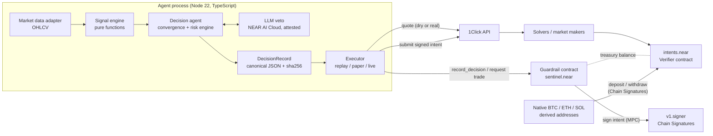
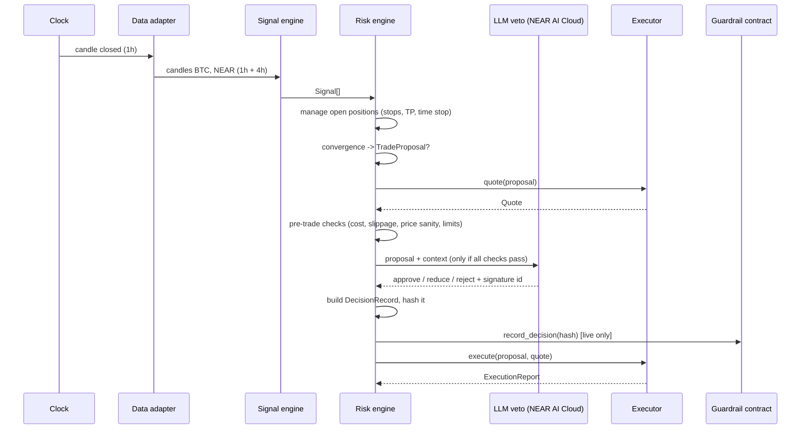

# Architecture — NEAR Sentinel (working name)

> Design drafted during the preparation phase (October 2026). Implementation began on 1 Nov 2026, the first day of NEAR HACKATHON.

> An autonomous spot-trading agent whose risk limits are enforced on-chain and whose every decision can be replayed and verified by anyone.

Sections marked **[VALIDATE]** depend on a preparation spike result that is still pending.

---

## 1. Thesis

Trading bots are not new. What is missing is a bot you can **trust with money without trusting its operator**. Sentinel's claim is narrow and testable:

1. **Bounded authority.** The agent can only do what an on-chain policy allows: trade listed assets, within per-trade and per-day caps, and never move funds out of the treasury except to the owner.
2. **Replayable decisions.** Every decision is a pure function of recorded inputs. Its hash is anchored on NEAR. `pnpm verify <hash>` recomputes it.
3. **Attested reasoning.** The only LLM in the loop runs on NEAR AI Cloud inside a TEE. Its output is signed, and that signature is stored in the decision record.
4. **Cross-chain settlement without a custodian.** Trades settle through NEAR Intents (solver competition plus atomic settlement on `intents.near`). Native BTC/ETH/SOL move in and out through Chain Signatures.

The trading strategy is a plugin. **The trust infrastructure is the product.**

## 2. Non-goals

- **No claim of alpha.** The default strategy (Bollinger breakout plus RSI, FVG and BTC-regime confirmation) is a reference implementation, chosen because it is explainable.
- **Spot only, long-only.** No leverage, no perps, no shorting. "Risk-off" means exiting to a stablecoin.
- **Single owner.** No pooled user funds, so no vault accounting, no deposits from third parties.
- **No mainnet custody of meaningful sums.** Live mode runs with small notional amounts.

## 3. System context



## 4. Modules

| Module | Path | Responsibility | Side effects |
|---|---|---|---|
| Market data | `src/data/` | Fetch and normalise OHLCV into `Candle[]`. Source behind an interface. | Network (live/paper only) |
| Signal engine | `src/signals/` | RSI, Bollinger bands and squeeze, FVG detection, rolling correlation, regime. | **None.** Pure functions. |
| Decision agent | `src/decision/` | Convergence scoring, risk engine (sizing, SL/TP, portfolio limits), LLM veto, DecisionRecord. | LLM call only |
| Execution | `src/execution/` | One `Executor` interface with four implementations. | Network, chain |
| Guardrail contract | `contracts/guardrail/` | On-chain policy, decision-hash log, MPC signing gate. | Chain |
| CLI | `src/cli.ts` | `demo`, `paper`, `live`, `verify`, `status`. | — |

The full risk logic is specified in [`RISK_ENGINE.md`](./RISK_ENGINE.md).

## 5. Core types

These types are the contract between modules. Amounts that touch the chain are `bigint` in the asset's smallest unit. Prices and indicators are `number`.

```ts
type AssetSymbol = "BTC" | "NEAR" | "USDC";

interface Candle {
  openTime: number;        // ms since epoch, UTC
  open: number; high: number; low: number; close: number;
  volume: number;
}

interface Signal {
  kind: "BB_BREAKOUT" | "RSI_MOMENTUM" | "FVG_SUPPORT" | "BTC_REGIME" | "RSI_EXHAUSTION";
  asset: AssetSymbol;
  barTime: number;
  direction: "bullish" | "bearish" | "veto";
  strength: number;        // 0..1, deterministic
  evidence: Record<string, number>; // the raw numbers behind the signal
}

interface TradeProposal {
  asset: AssetSymbol;
  side: "BUY" | "SELL";    // BUY = USDC -> asset, SELL = asset -> USDC
  reason: "ENTRY" | "STOP" | "TAKE_PROFIT_1" | "TAKE_PROFIT_2" | "TIME_STOP" | "KILL_SWITCH";
  notionalUsd: number;
  stopPrice?: number;
  takeProfit?: [number, number];
  signals: Signal[];
}

type RiskVerdict =
  | { ok: true; proposal: TradeProposal; checks: CheckResult[] }
  | { ok: false; reason: RejectReason; checks: CheckResult[] };

interface Quote {
  originAsset: string; destinationAsset: string;   // 1Click assetIds
  amountIn: bigint; amountOut: bigint; minAmountOut: bigint;
  depositAddress?: string; deadline: string;
  raw: unknown;                                    // exact API payload, kept for the record
}

interface ExecutionReport {
  mode: "replay" | "paper" | "live";
  status: "SIMULATED" | "QUOTED" | "SUCCESS" | "REFUNDED" | "FAILED";
  quote?: Quote;
  intentHash?: string;
  txRefs: string[];
}

interface Executor {
  readonly mode: ExecutionReport["mode"];
  quote(p: TradeProposal): Promise<Quote>;
  execute(p: TradeProposal, q: Quote): Promise<ExecutionReport>;
  balances(): Promise<Record<AssetSymbol, bigint>>;
}
```

## 6. Lifecycle of one tick

One tick runs on each candle close of the execution timeframe (1h by default).



Two rules hold at every step:

- **Position management runs before new entries.** An exit is never delayed by a slow entry evaluation.
- **Rejected decisions are recorded too.** A judge can see the agent saying no, and why.

## 7. Execution modes

| Mode | Data | Quotes | Settlement | Keys needed | Purpose |
|---|---|---|---|---|---|
| `replay` | Fixtures in `fixtures/` | Fixture quotes | Simulated fills at quote price | None | Deterministic demo and tests; works offline. |
| `paper` | Live OHLCV | Real 1Click quotes with `dry: true` | Simulated | 1Click JWT recommended | Live behaviour with zero funds at risk. |
| `live` | Live OHLCV | Real quotes | NEAR Intents (signed intent, Intents balance) | Agent key, 1Click JWT, NEAR AI key | Real trades, small notional. |
| `verify` | Decision record | — | — | None (reads chain) | Recompute a decision and compare with the anchored hash. |

`pnpm paper` (`src/cli/run.ts`) runs the `paper` mode until Ctrl+C: one tick 15 s after each 1h close (a bar is never ticked twice, across restarts too), the price watcher every 60 s in between, one step at a time through a single queue. State lives in `state/paper/` (portfolio, paper balances, idempotency keys, heartbeat), candles in `data/candles/` (both git-ignored), decisions in `records/`. Ctrl+C lets the step in progress finish before exiting. `pnpm status paper` shows the paper portfolio and alerts when the heartbeat is older than 5 minutes. `pnpm live` is refused until live execution lands (#47).

`replay` is the default for `pnpm demo`. When the network is available, `demo` also requests one real dry quote and prints it next to the fixture quote. If the request fails, it says so and continues.

## 8. Settlement design

### 8.1 Why the treasury lives inside NEAR Intents

The treasury (USDC, NEAR, BTC) is held as balances on the Verifier contract `intents.near`, not on origin chains. Quotes use `depositType: INTENTS` and `recipientType: INTENTS`. A trade is a signed `token_diff` intent submitted through `POST /v0/submit-intent`. There is no on-chain deposit to wait for, so a trade completes in seconds and needs no gas on foreign chains.

### 8.2 Who signs the intent — two tiers

This is the most important design decision, and the guarantee differs by tier. We state both honestly.

| | Tier 1 (MVP) | Tier 2 (target) **[VALIDATE]** |
|---|---|---|
| Intent signer | Agent's own ed25519 key, registered on `intents.near` for the treasury account | The guardrail contract, through Chain Signatures (`v1.signer`, domain `1` = Ed25519). The derived public key is registered on `intents.near` for the contract account. |
| Where the policy is enforced | Agent process (risk engine) | **Contract.** It parses the intent, checks it against the policy, and only then requests the MPC signature. |
| If the agent host is compromised | Attacker can sign any intent for the treasury balance | Attacker can only trade within on-chain limits. Withdrawals go to the owner only. |
| Latency | ~instant signing | One MPC round per trade (seconds). Acceptable on a 1h timeframe. |

Tier 2 is what makes the "bounded authority" claim true. It depends on two facts we have not yet confirmed and will test in the preparation spikes: that `intents.near` accepts a public key added by a contract account and verifies an MPC-produced Ed25519 signature over a NEP-413 payload. If the spike fails, we ship Tier 1, keep the treasury small, and say so in the README.

### 8.3 Chain Signatures for native assets

Native BTC, ETH or SOL enter and leave the treasury through addresses derived from the treasury account. We use **one derivation path per chain** (`bitcoin-1`, `ethereum-1`, `solana-1`), so a signature produced for one chain cannot be replayed on another. Deposits go through the bridge deposit flow into `intents.near`. Withdrawals out of Intents are restricted by the contract to owner-designated addresses.

This path is not on the critical trading path. It is a week-2 feature.

## 9. Guardrail contract (`contracts/guardrail`, Rust, near-sdk 5)

### 9.1 State

```rust
pub struct Policy {
    pub owner: AccountId,
    pub agent: AccountId,                       // only caller allowed to request trades
    pub allowed_assets: Vec<String>,            // 1Click / Intents asset ids
    pub max_amount_per_trade: HashMap<String, U128>,  // per asset, smallest unit
    pub max_daily_amount: HashMap<String, U128>,      // rolling UTC day
    pub max_trades_per_day: u32,
    pub paused: bool,                           // owner or agent can pause; only owner can unpause
}
```

### 9.2 Methods

| Method | Caller | Effect |
|---|---|---|
| `record_decision(hash, kind)` | agent | Appends `{hash, kind, block_timestamp}`. Emits an event. |
| `request_trade_signature(intent_json, decision_hash)` | agent | Tier 2 only. Validates the intent against the policy, then calls `v1.signer.sign`. Rejects if `decision_hash` was not recorded first. |
| `pause()` | owner, agent | Kill switch. |
| `unpause()`, `set_policy(..)` | owner | Policy changes. |
| `get_decision(hash)`, `get_policy()`, `get_day_usage()` | anyone | Views used by `verify` and by judges. |

### 9.3 What the contract can and cannot enforce

The contract has no price oracle, so it enforces limits in **token units**, not dollars.

| Rule | Enforced by |
|---|---|
| Only allowed assets appear in a `token_diff` | Contract (Tier 2) |
| Per-trade and per-day amount caps per asset | Contract (Tier 2) |
| No `transfer` / `ft_withdraw` intents except to `owner` | Contract (Tier 2) |
| Trade was preceded by a recorded decision | Contract (Tier 2) |
| Risk per trade, drawdown, daily loss in USD, stop-loss logic | Agent risk engine (both tiers) |

## 10. Decision records and verification

A `DecisionRecord` captures everything needed to reproduce a decision:

```ts
interface DecisionRecord {          // src/types.ts, built by src/decision/record.ts
  version: 1;
  agentVersion: string;             // git commit
  configHash: string;               // sha256 of the canonical risk config
  asset: "BTC" | "NEAR";
  barTime: number;                  // openTime of the closed 1h bar
  inputs: {
    candles: CandleWindowRef[];     // NEAR 1h, BTC 1h, BTC 4h (closed by the bar's close): sha256 of each window
    portfolio: PortfolioSnapshot;   // state the decision was taken on (exits: before this bar's exits)
    now: number;                    // tick time
    externals: {                    // every answer from outside the engine, in call order
      authenticated: boolean; policy?: { paused: boolean; maxAmountInUsd: number };
      calls: ExternalCall[];        // quote | clock | balances | executed | llm (raw answer or error)
    };
  };
  signals: Signal[];
  checks: CheckResult[];            // every rule evaluated, passed or not
  llm?: LlmReview;                  // verdict, rationale, chatId, TEE signature
  outcome:
    | { action: "TRADE"; proposal: TradeProposal }
    | { action: "REJECT"; reason: RejectReason; proposal?: TradeProposal }
    | { action: "HOLD"; reason: RejectReason | "NO_SIGNAL" };
}
```

- Serialised with **RFC 8785 JSON canonicalisation**, then hashed with SHA-256.
- The full record is written to `records/<hash>.json` (and, in live mode, to a public store). The file holds exactly the canonical bytes that were hashed, so `sha256sum records/<hash>.json` gives back `<hash>` with any tool. Only the hash goes on-chain.
- Every decision is recorded (and, in live mode, anchored) **before** its trade executes; holds, rejections and exits included.
- `pnpm verify <hash>` loads the record and checks, in order (`src/decision/verify.ts`): the record hashes to `<hash>`; `configHash` names a known configuration; each candle window matches the market data (SHA-256); the decision recomputed with the same code, reading every external answer back from `inputs.externals` in the order the engine asks for it, gives the same record byte for byte (the first difference is reported by its path, e.g. `outcome.action`); the LLM answer's ed25519 signature verifies over the text rebuilt from the stored model id and byte hashes, consistently with the `llm.attestation` status recorded at decision time; and `<hash>` is anchored in the contract (CLI, #31).
- The LLM part is not recomputed (it is not deterministic). It is verified instead: the stored signature is checked against the NEAR AI Cloud signing identity.

## 11. LLM usage

The LLM never proposes or sizes a trade. It receives a proposal that has already passed every deterministic check and may only return:

```json
{ "verdict": "approve" | "reduce" | "reject", "sizeMultiplier": 1 | 0.5 | 0, "rationale": "<= 400 chars" }
```

- Model served by NEAR AI Cloud (`https://cloud-api.near.ai/v1`, OpenAI-compatible).
- We keep the exact request and response bytes and fetch the response signature from `/v1/signature/{chat_id}`.
- Attestation (`src/decision/llm/attestation.ts`): before the completion, a preflight report with a fresh client nonce lists the gateway and model TEE signer keys. After it, the ed25519 signature must verify, its text must be exactly `model:request_hash:response_hash` (`provider_tee`) or `request_hash:response_hash` (`gateway`) computed from our bytes, and the signer must be a preflight key of that kind. Result: `verified`, `invalid` (signature does not verify) or `unverified` (incomplete or not bound to us). Hardware quotes (TDX, NVIDIA) are not re-verified here.
- Output is validated with Zod. Any invalid output, timeout (10 s) or API error is treated as `reduce` with multiplier `0.5`, and the record says why. The LLM can make a trade smaller, never larger, and its failure cannot block an exit.
- Veto (`src/decision/llm/veto.ts`): one 10 s budget covers preflight, completion and signature lookup. The prompt carries the engine's numbers only (prices, stop, targets, signal evidence, last 24 closes, day P&L, open exposure). An answer that fails the Zod schema becomes the fallback but keeps its evidence (chat id, hashes, signature), so the record shows what the model actually said. Weak attestation never changes the verdict; it is recorded as `unverified` or `invalid`.
- Exits (stops, take-profits, kill switch) **never** go through the LLM.

## 12. Threat model

| Threat | Mitigation |
|---|---|
| Agent host compromised | Tier 2 contract limits; small treasury; owner can pause. |
| Bad or manipulated quote | Price sanity check: quote-implied price must be within 1% of the reference price from the data feed; slippage tolerance 50 bps on entries (150 bps on exits); 2-minute deadline. |
| Stale or missing market data | Tick is skipped if the last candle is older than 1.5 bars; no new entries on stale data; exits evaluated with the freshest available price. |
| LLM prompt injection via market data | LLM receives numbers and fixed fields only, no free text from external sources; it can only reduce size. |
| Agent offline while in a position | Stops are evaluated by the agent, not resting on an exchange. Mitigated by per-position size cap and a liveness alert. Stated as a known limitation. |
| Replay of a signature across chains | One derivation path per chain. |
| Secrets in the repository | Keys only in environment variables; `.env` ignored; CI secret scan. |
| Double execution after a restart | Each proposal has an idempotency key `(asset, barTime, reason)`; the executor refuses a second execution of the same key. |

## 13. Technology choices

| Decision | Choice | Why |
|---|---|---|
| Language | TypeScript, Node 22 | Same language as `near-api-js`, the Shade Agent API and the NEAR agent skills. |
| Validation | Zod | Every external payload (1Click, NEAR AI, Binance) is parsed, never trusted. |
| Tests | Vitest | Fast; fixtures make the signal and risk engines fully deterministic. |
| Market data | Binance `data-api.binance.vision` (keyless, market-data only) | Free OHLCV at any interval. Behind an interface, so it can be swapped. |
| Settlement | NEAR Intents via 1Click, Intents-balance mode | Solver competition, atomic settlement, no foreign gas. |
| LLM | NEAR AI Cloud | TEE attestation and response signatures. |
| Contract | Rust, near-sdk 5 | Reference stack for NEAR contracts. |

## 14. Repository layout

```
near-sentinel/
├── README.md              # "Do X -> see Y" for humans and AI judges
├── ARCHITECTURE.md        # this file
├── RISK_ENGINE.md         # risk specification
├── .agents/skills/        # near-intents, near-api-js, near-ai-cloud
├── src/
│   ├── data/              # feed.ts, binance.ts, fixtures.ts
│   ├── signals/           # rsi.ts, bollinger.ts, fvg.ts, atr.ts, correlation.ts, regime.ts
│   ├── decision/          # convergence.ts, risk-engine.ts, llm-veto.ts, record.ts
│   ├── execution/         # executor.ts, replay.ts, paper.ts, intents.ts, chainsig-treasury.ts
│   ├── config/            # schema.ts, default.ts
│   └── cli.ts
├── contracts/guardrail/   # Rust contract + sandbox tests
├── fixtures/              # frozen candles and quotes for replay
├── records/               # decision records produced by runs
└── test/                  # unit, property and end-to-end replay tests
```

## 15. Hackathon fit

- Tracks: `defi` (primary), `security`, `agents`.
- NEAR components used: NEAR Intents (1Click, signed intents, Verifier contract), Chain Signatures (`v1.signer`), NEAR AI Cloud (attested inference), NEAR smart contract (guardrails).
- All application code is written between 1 and 14 Nov 2026. This document and `RISK_ENGINE.md` were drafted in the preparation phase.

## 16. Open questions

1. **[VALIDATE]** Tier 2 signing: can a contract account register an MPC-derived Ed25519 key on `intents.near` and have its NEP-413 intents accepted? (Spike P5.)
2. ~~Asset ids~~ **Resolved (P1, 19 Oct):** BTC is traded as nBTC (`nep141:nbtc.bridge.near`), quoted within 0.10% of the reference price; wBTC was rejected (1.20% deviation). Asset ids are pinned in config, never resolved by symbol. Still open: minimum trade size for Intents-to-Intents swaps.
3. Can Binance klines be redistributed in a public repository's fixtures? If not, `fixtures/` stores a short window plus a fetch script.
4. ~~LLM model~~ **Resolved (P2, 19 Oct):** `Qwen/Qwen3.6-35B-A3B-FP8` returned `provider_tee` signatures and valid veto JSON on 10/10 runs, mean latency 3.68 s.
