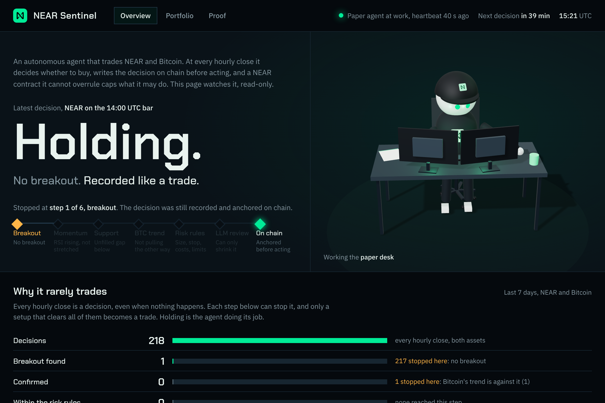

# NEAR Sentinel

An autonomous spot-trading agent you can check instead of trust. Every hourly decision, including "do nothing", is recorded, hashed, and anchored on NEAR before anything happens. A guardrail contract the agent cannot overrule caps how often it may trade and can pause it. Anyone can recompute any decision from its recorded inputs.

Built at NEAR HACKATHON, 1 to 14 November 2026.



## Check it in a minute

Nothing here asks you to take our word for it.

- **In a browser, no install.** Open the testnet guardrail on [NearBlocks](https://testnet.nearblocks.io/address/guardrail.near-sentinel-enzo.testnet): each `record_decision` call is one hourly decision, written before the agent was allowed to act. The two real swaps are on mainnet: [USDC to NEAR](https://nearblocks.io/txns/BZw8CY6j9sZU2ymZzT1tzw3NUofuV1KiLm5j8k3xNNkj) and [back](https://nearblocks.io/txns/DCws6QWLcUUmuwEqiaVrehkU1VEC7DLEjeZRhQXxbHtz).
- **In a terminal, two commands.** `corepack pnpm install && corepack pnpm demo` replays a trade and a refusal offline, with no key. `corepack pnpm verify --all` then recomputes every decision and must land on the same bytes.
- **Try to cheat.** `corepack pnpm dashboard` opens a local page whose Proof tab re-hashes any anchored record in your browser. Press "Change one digit": the fingerprint no longer matches the one on chain, and the page says so.

## Why it mostly holds, and why that is the point

In the week shown above, the paper agent took 218 decisions and stopped 217 of them at the first step: no breakout, no trade. A bot that only shows its wins could hide those hours. Sentinel records and anchors each one exactly like a trade, so its track record cannot be cherry-picked, including by us.

What is submitted is the trust layer, not a money machine: evidence before execution, limits the agent cannot lift, and an LLM that can only reduce risk. The strategy is deliberately plain so that every refusal can be explained and replayed. To see the agent act, the offline demo replays one confirmed breakout (entry, two targets) and one refused setup.

## The problem

A trading bot usually asks you to trust whoever runs it: that it follows its own rules, that it did not cherry-pick its track record, and that it stays within its limits. Sentinel makes those claims checkable:

- **Every decision leaves evidence.** It is written as canonical JSON (RFC 8785) and hashed with SHA-256. The hash goes on chain before execution, so a decision cannot be rewritten after the fact.
- **Decisions are replayable.** `pnpm verify <hash>` recomputes a decision from its recorded inputs and must land on the same bytes.
- **The limits live on chain.** A NEAR contract holds the policy: which account may act, how many new positions per UTC day, and a pause only the owner can lift. Exits are never blocked, so a stop always goes through. The agent's on-chain key can call only `record_decision` and `pause`.
- **The LLM can only say less.** A model on NEAR AI Cloud reviews a setup only after every deterministic rule passed. It can keep, halve, or refuse the size, never increase it. Its answer is signed inside a TEE, and the signature is stored in the record.

The strategy itself (a Bollinger squeeze breakout confirmed by RSI, an unfilled fair value gap and the Bitcoin trend) is a plain, explainable reference. No alpha is claimed. The trust layer is the product.

## Try it in two commands

You need Node 22.18 or later. There is no build step and no key, and it works offline.

```bash
corepack pnpm install
corepack pnpm demo
```

You will see two frozen market scenarios replayed bar by bar:

- `demo-entry`: the agent buys NEAR on a confirmed breakout, takes half profit at target 1 and the rest at target 2 (+$7.44 on $1,000).
- `demo-refusal`: the same kind of breakout, but RSI is at 82.5, so the agent refuses. NEAR fell 4.7% over the next 24 hours.

Each line ends with a record hash. Then check them all, or just one:

```bash
corepack pnpm verify --all         # recomputes every record the demo wrote
corepack pnpm verify <hash>        # one record: paste any hash, or its first 8 characters, from the demo output
```

The hashes change with each version of the code, because every record names the exact commit that produced it. That is why no hash is printed here.

`verify` confirms that the file hashes to its name, that the configuration is known, that the candles match the market data byte for byte, and that recomputing the decision with the same code gives the same record. Add `--anchor <contract> --network testnet|mainnet` to also check that the hash is on chain.

To browse every decision in a single offline page:

```bash
corepack pnpm explorer             # writes explorer/dist/index.html, open it in a browser
```

## Proof it runs for real

| What | Where |
|---|---|
| Real swap, USDC to NEAR: 5.00 USDC for 1.4056 NEAR at 3.5573, settled in 24 s (10 Nov 2026, 21:30 UTC) | intent `G86AnT8awmtcnVLpEom8hrPhPK5egweyJWPkqHHhMJK`, [transaction](https://nearblocks.io/txns/BZw8CY6j9sZU2ymZzT1tzw3NUofuV1KiLm5j8k3xNNkj) |
| Real swap, NEAR to USDC: 1.4056 NEAR for 4.9897 USDC at 3.5499, settled in 24 s (10 Nov 2026, 21:36 UTC) | intent `HcuVZggqTyWfg6jqDzCH93LZAEmwE8T92X1wL5i97zzN`, [transaction](https://nearblocks.io/txns/DCws6QWLcUUmuwEqiaVrehkU1VEC7DLEjeZRhQXxbHtz) |
| Round-trip cost | 0.0103 USDC, 0.21% of the amount |
| Mainnet guardrail contract | [`near-sentinel-enzo-guardrail.near`](https://nearblocks.io/address/near-sentinel-enzo-guardrail.near), agent `near-sentinel-enzo-agent.near` |
| Testnet guardrail, anchoring the paper agent's hourly decisions | [`guardrail.near-sentinel-enzo.testnet`](https://testnet.nearblocks.io/address/guardrail.near-sentinel-enzo.testnet), agent `agent.near-sentinel-enzo.testnet` |
| An attested LLM review (NEAR AI Cloud, `Qwen/Qwen3.6-35B-A3B-FP8`) | `test/live/recorded/nearai-veto.json`. Its signature is re-checked offline by `test/decision/llm/recorded.test.ts`. |

Both swaps were signed by the agent's own key through the same executor the agent uses (`scripts/swap-once.ts`). The evidence files, holding the quote, the intent payload, the intent hash and the final status (no secret), are in `test/live/recorded/`.

## How one decision is made

At every hourly close, for NEAR and for Bitcoin:

1. **Breakout.** Did the price break out of a Bollinger squeeze? If not, hold.
2. **Confirmations.** Momentum (RSI rising but not stretched), an unfilled gap below as support, and a Bitcoin trend that does not pull the other way. A stretched RSI or a hostile Bitcoin trend is a veto.
3. **Risk rules.** Risk of at most 1% of equity, stop distance, costs against the target, daily loss, trades per day, cooldown after a stop, fresh data, and a live quote close to the market price.
4. **LLM review.** Only now, and it can only shrink or refuse the trade.
5. **Record and anchor.** The decision is hashed and written to the guardrail contract. If anchoring fails, nothing is executed and the bar is retried.
6. **Execute.** Paper mode simulates the fill at a real quote. Live mode signs a NEAR Intents swap, after checking the payload's signer, deadline, token, amount and recipient against the quote.

Open positions are managed before any new entry. Exits (stop, targets, time stop, kill switch) never go through the LLM. The full rules are in [RISK_ENGINE.md](./RISK_ENGINE.md), and the design is in [ARCHITECTURE.md](./ARCHITECTURE.md).

## NEAR components used

| Component | How Sentinel uses it |
|---|---|
| NEAR Intents (1Click API, `intents.near` verifier) | Quotes, intent generation, NEP-413 signed swaps between balances inside Intents, and balances read with `mt_batch_balance_of` |
| NEAR smart contract (Rust, near-sdk 5) | `contracts/guardrail`: the decision log, the daily trade cap, the pause, and owner-only unpause and policy changes. It emits NEP-297 events and is tested in a local sandbox. |
| NEAR access keys | A function-call key restricted to `record_decision` and `pause`, so the agent process never holds a full-access key |
| NEAR AI Cloud | The LLM review, with TEE attestation: a preflight report with a client nonce, and an ed25519 response signature bound to our request and response hashes |

Chain Signatures are **not** used in the shipped version (see Tier 1 below).

## What is guaranteed, and what is not

This ships as **Tier 1**: the agent signs its own intents.

| Claim | Enforced by |
|---|---|
| Every decision is anchored before it is executed | Agent code. Live mode refuses to start without the guardrail, and the contract rejects a new position while paused or over the daily cap. Exits (stops, targets) are always accepted. |
| No more than N new positions per UTC day, and a pause that only the owner can lift | Contract |
| The agent's NEAR key cannot move funds, deploy, or change the policy | NEAR access-key permissions |
| A decision cannot be altered after the fact | SHA-256 hash on chain, plus `pnpm verify` |
| Size, stop, 1% risk, daily loss, slippage, price sanity | Agent risk engine, not the contract |
| The intent matches the quote (signer, token, amount, recipient, deadline) | Agent, checked before signing |

What this means in practice:

- **The agent host is trusted for amounts.** Its intent key can trade, and could withdraw, the agent's NEAR Intents balance, so that balance is kept small (about $10) and each live trade is capped by `LIVE_MAX_NOTIONAL_USD`. Tier 2, where the contract checks each intent and requests an MPC signature through Chain Signatures, is designed in ARCHITECTURE.md §8.2 and §16.1 but not built.
- **The contract caps trades in count, not in dollars.** It has no price oracle.
- **Long-only spot.** In a falling market the agent mostly holds. That is intended: risk-off means staying in USDC.
- **A swap with no final answer halts the agent.** If 1Click does not confirm a swap within 3 minutes, or the connection drops right after the signed intent is sent, the agent stops trading (ticks and stops alike) instead of guessing. The owner checks the intent, then restarts with `pnpm live --yes-real-funds --resume`.
- **Stops are evaluated by the agent**, every 60 s between closes, not resting on an exchange. If the agent is offline, a stop waits for it to come back. The dashboard and `pnpm status` raise an alert when the heartbeat is older than 5 minutes.
- **LLM attestation is partial.** We verify the ed25519 signature and bind it to our exact bytes and to the signer keys listed in the attestation report. We do not re-verify the hardware quotes (Intel TDX, NVIDIA).
- **Market data comes from Binance** (`data-api.binance.vision`, keyless). The dashboard chart shows the Hyperliquid NEAR perpetual for display only. Decisions never use it.

## Run it yourself

Copy `.env.example` to `.env` and fill in only what each mode needs. Keys stay in `.env`, which git ignores.

| Command | What it does | Needs |
|---|---|---|
| `pnpm demo`, `pnpm verify <hash>`, `pnpm explorer` | Offline replay, verification, and the decision explorer | Nothing |
| `pnpm paper` | Runs on the real market with simulated money until Ctrl+C. One decision per asset at each 1h close, and stops watched every 60 s. | `ONECLICK_JWT` recommended; `NEARAI_API_KEY` for the LLM review |
| `pnpm dashboard` | Local, read-only live page on http://127.0.0.1:4747. Its Proof tab re-hashes any anchored record in your browser and shows the contracts, swaps and signed LLM review behind each claim. | Nothing (reads `state/`, `records/` and the chain) |
| `pnpm status paper` | The paper portfolio and heartbeat in the terminal | Nothing |
| `pnpm live --yes-real-funds` | The same loop with real swaps inside NEAR Intents | The mainnet guardrail and a live key, set up below |

**Anchoring on testnet** (paper mode), run once with your own testnet account. The script creates `agent.<you>.testnet` and `guardrail.<you>.testnet`, deploys the contract, and writes the agent's restricted key to `.env`:

```bash
node scripts/deploy-guardrail.ts --network testnet --owner <you>.testnet
```

Each anchored decision stays in the contract's storage, about 130 bytes, or 0.0013 NEAR locked from the contract's balance. The paper agent anchors two decisions an hour, about 0.06 NEAR a day. When the balance runs out, anchoring fails and the agent stops trading (it never trades unanchored), so top the contract up from the owner account now and then.

**Live mode on mainnet**, run once by the owner. Each step asks for an explicit flag:

```bash
node scripts/deploy-guardrail.ts --network mainnet --owner <owner> --prefix <name> --yes-mainnet
node scripts/setup-live-key.ts --agent <name>-agent.near --yes-mainnet
node scripts/fund-intents.ts --from <owner> --to <name>-agent.near --usdc 10 --yes-mainnet
node scripts/swap-once.ts --usdc 5 --yes-real-funds        # optional: one swap to prove the path
```

**Checks:**

```bash
pnpm check            # typecheck + unit, property and golden tests
pnpm contract:test    # the guardrail's Rust unit tests (needs Rust)
```

## Repository map

```
src/signals/      indicators and signals (pure functions)
src/decision/     convergence, risk engine, LLM review, decision records, verify
src/execution/    paper and live executors, 1Click client, on-chain anchoring, price watcher
src/dashboard/    the local live page
src/explorer/     the offline decision explorer
contracts/guardrail/   the NEAR contract (Rust) and its committed wasm
scripts/          one-time setup run by the owner (deploy, keys, funding, one swap)
fixtures/         frozen market data for the demo and the tests
test/             unit, property, golden, sandbox-contract and recorded live tests
```

## Licence

The code is under the [MIT licence](./LICENSE).

The candles in `fixtures/` (and embedded in the explorer) are Binance market data from Binance Vision, licensed under CC BY-NC-SA 4.0, for non-commercial use. See `fixtures/README.md`. Live candles are never committed.
